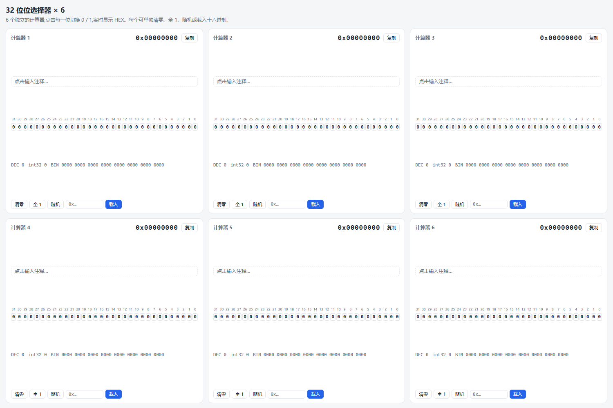
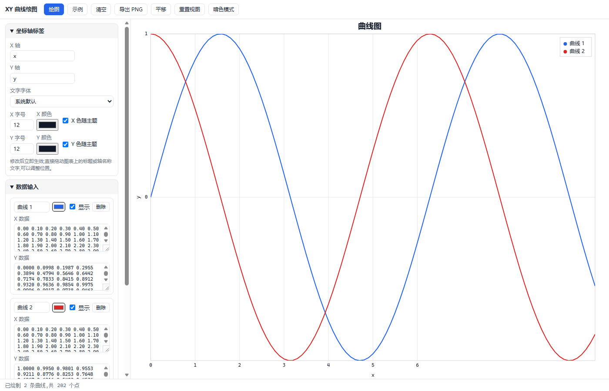
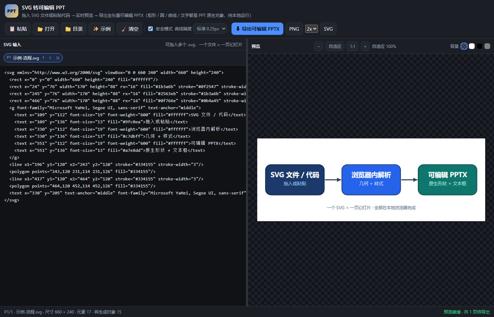
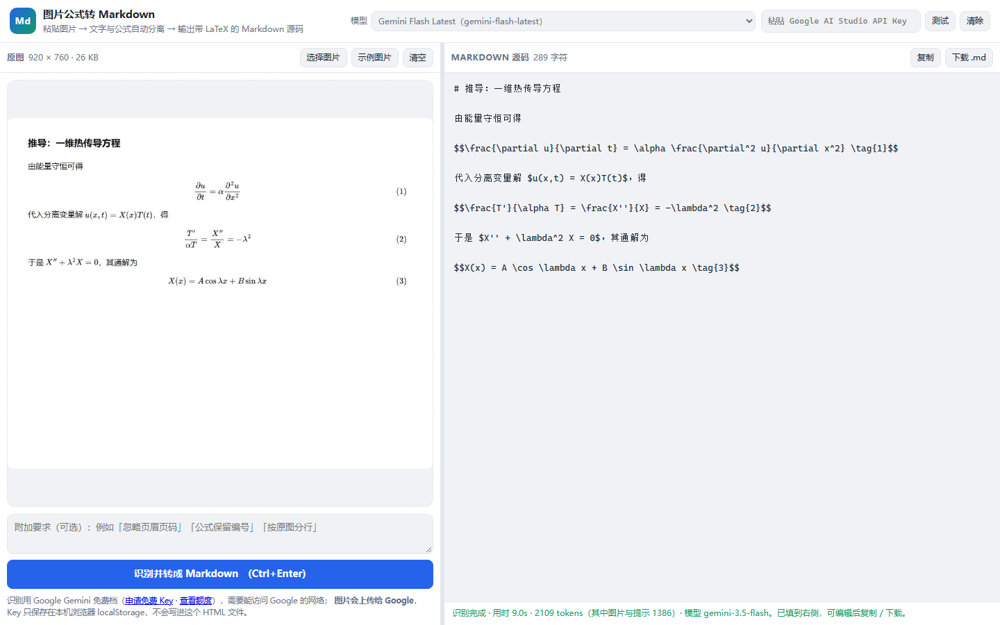
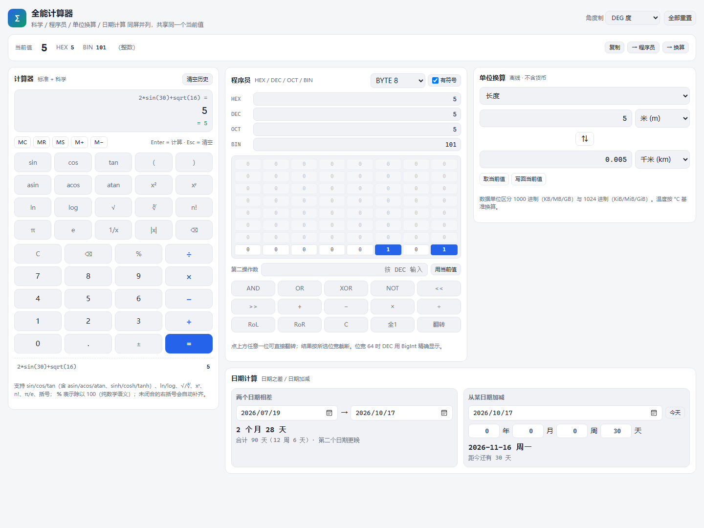
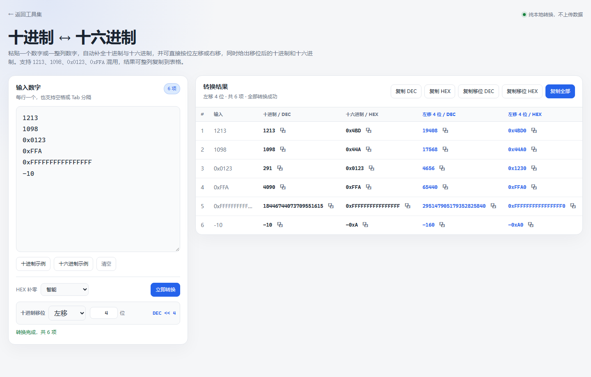

# Tools 工具集

[中文](README.md) | [English](README_EN.md)

一个轻量的网页工具集合,全部由纯 HTML + CSS + JavaScript 编写。下载后直接用浏览器打开即可使用,无需安装依赖,大部分工具完全离线可用。

## 包含工具

### 1. 32 位位选择器 × 6(`bit-to-hex-x6.html`)

一页内提供 6 个相互独立的 32 位数值编辑器,适合拼装寄存器值、掩码或配置字。

功能:

- 32 位二进制逐位开关,顶部带位号(31 → 0),悬停可查看权重
- 实时显示 HEX、无符号十进制、int32 有符号十进制、二进制
- 6 个计算器完全独立,各自支持:清零、全 1、随机、输入 HEX 载入、一键复制
- 每个计算器可填写简短注释,自动保存到浏览器本地(`localStorage`),刷新不丢失
- 自适应布局铺满屏幕:宽屏(≥1400px)3 列 × 2 行,中屏 2 列 × 3 行,手机单列,每卡内位按钮自动折成两排
- 自动适配浅色 / 深色系统主题



### 2. XY 曲线绘图·简易版(`xy-plotter.html`)

最简版数据曲线工具:X、Y 数据分两个文本框粘贴,点「绘图」即可查看曲线,支持同时绘制多条曲线。

功能:

- 多条曲线:点「+ 新增曲线」可任意添加,每条曲线有独立的 X / Y 输入框、名称、颜色,支持删除与显示 / 隐藏;X 留空时自动使用 0, 1, 2, …;数量不一致时按较少一侧绘制
- 标题与轴标签:可修改文字、字体、字号、颜色,并可直接在画布上拖动位置(位置自动保存)
- 坐标轴:线性 / Log10 缩放(自动过滤 0 与负数并提示)、网格开关、折线 / 平滑曲线
- 选点读取:单击数据点可添加/取消标记,支持同时标记多个点并列出各自坐标,「清除全部标记」一键清空
- 刻度方式可选:自动漂亮数(1/2/5×10ⁿ)、等分 N 段、固定步长、数据点位置、自定义刻度列表
- 区间统计与拟合:手动、当前视图或 Shift+拖动选择 X 范围,按原始/显示数据统计均值、标准差、RMS、峰峰值,并显示线性拟合斜率、截距和 R²
- 交互:图例点击显隐曲线、鼠标悬停显示曲线名与精确坐标、框选放大、按住空格或「平移」拖动、双击重置视图
- 数据导出 / 载入:一键导出 CSV 或 Excel;Excel 包含曲线数据、说明和图表图片三个 Sheet,CSV / TXT / XLSX 均可恢复曲线、列名与解释说明
- 导出文件名:工具栏可填写统一文件名;留空时使用图表标题,填写后严格按文本框内容生成 PNG、CSV 和 XLSX
- 解释说明:侧边栏可填写不显示在图表中的实验说明;内容自动保存,并作为独立元数据字段写入 CSV
- 自动保存:标题、轴标签的文字/字体/字号/颜色与位置、曲线列名、坐标轴与刻度设置、曲线数据都会保存在当前浏览器,刷新后原样恢复
- 导出 PNG;亮色 / 暗色主题切换;完全离线,无任何外部依赖



#### 快速开始

1. 打开 `xy-plotter.html`。
2. 在第一条曲线的「X 数据」和「Y 数据」文本框中粘贴数值。数字可以用空格、逗号、分号或换行分隔。
3. 点击工具栏「绘图」生成曲线。
4. 根据需要设置曲线名称、颜色、线宽、X/Y 列名、标题、坐标轴和显示样式。
5. 使用统计、毛刺清理、标记或测量光标分析数据。
6. 通过「导出 PNG」「导出 CSV」或「导出 Excel」保存结果。

X 数据留空时，会自动使用 `0, 1, 2, …` 作为 X 值。X 和 Y 数量不一致时，只使用较短一侧能够配对的点数；无法解析的非数字内容会被忽略。

#### 多曲线设置

- 「+ 新增曲线」可以添加任意数量的曲线。
- 每条曲线有独立的名称、颜色、线宽、显示开关和 X/Y 数据。
- 「X 列名」「Y 列名」用于控制 CSV/Excel 表头，默认为 `X`、`Y`。例如曲线名为 `Ain0`、列名为 `Voltage`、`Code` 时，表头是 `Ain0 Voltage` 和 `Ain0 Code`。
- 曲线名称、颜色、线宽、显示状态、列名和数据都会自动保存。
- 图例可以点击，用于快速显示或隐藏对应曲线。

#### 坐标轴、标题和刻度

- X/Y 轴均支持线性和 `Log10` 两种刻度。
- Log 轴只绘制正数，`0` 和负数会被过滤。
- 可设置 X/Y 轴标题、字体、字号和颜色。
- 图标题、X 轴标题、Y 轴标题可以直接在画布上拖动；位置会自动保存。
- 刻度方式包括：
  - 自动漂亮数：优先使用便于阅读的 1/2/5×10ⁿ 刻度。
  - 等分 N 段：把当前坐标范围平均分成指定段数。
  - 固定步长：按输入的固定间隔生成刻度。
  - 数据点：使用数据中实际出现的 X 或 Y 值。
  - 自定义：输入空格或逗号分隔的刻度列表。
- 「折线」只改变点与点之间的连线方式；「平滑曲线」只改变绘制外观，不会修改 Y 数值。

#### 毛刺清理与滑动平均

「毛刺清理」默认只处理显示层，不修改文本框中的原始数据。

- 中值滤波：窗口大小为 `N`，`k=(N−1)/2`，每个点替换为前后共 N 个 Y 值的中位数：

```text
y′[i] = median(y[i-k] … y[i+k])
```

- 滑动平均：在中值滤波结果上继续计算算术平均：

```text
y″[i] = (y′[i-k] + … + y′[i+k]) / m
```

其中 `m` 是边缘位置实际参与平均的点数。

- 窗口限制为 `3–21`，偶数会自动调整成奇数；窗口越大，平滑越强，但窄峰也可能被削弱。
- 处理顺序为：隐藏点/补线 → 中值滤波 → 滑动平均 → 绘图。
- 清理只修改显示层的 Y 值，X 值保持不变，也不会做降采样。
- 「擦除后平滑补线」用于在橡皮擦隐藏数据点后自动补出平滑连接。
- 勾选「导出处理结果」后，CSV 使用处理后的显示数据；默认 CSV 保留原始数据。
- PNG 始终反映当前显示层，包括清理、隐藏和补线效果。

#### 橡皮擦、撤销和恢复

- 开启工具栏「橡皮擦」后，可以单击或框选数据点并将其隐藏。
- 隐藏只影响显示，不删除文本框中的原始数据。
- 「撤销」「重做」「恢复隐藏点」可以恢复隐藏操作。
- 画布外按 `Ctrl+Z` 撤销，按 `Ctrl+Y` 或 `Ctrl+Shift+Z` 重做。
- 如果编辑了 X/Y 数据，已保存的隐藏点会自动清空，避免索引与旧数据错位。

#### 标记与测量光标

- 鼠标悬停在数据点附近时，会显示曲线名和精确 X/Y 值。
- 单击数据点可以添加或取消标记；可以同时标记多个点。
- 标记旁的坐标文字可以拖动；移开后会显示指引箭头。
- 「按值标记」会在指定曲线上寻找最接近输入 X 或 Y 的数据点。输入框内按回车也可以触发。
- 开启 X/Y 光标后，可以拖动两条竖线或横线测量 `ΔX`、`ΔY`。
- 光标读数框可以拖动位置；「重置视图」不会清除光标或标记。

#### 区间统计与线性拟合

统计区间有三种设置方式：

- 手动输入 X 最小值和最大值。
- 点击「全部数据」清除范围限制。
- 点击「当前视图」使用当前缩放后的 X 范围。
- 按住 `Shift` 在绘图区拖动，可以直接框选 X 统计区间；普通拖动仍然用于缩放。

「分析数据」可以选择：

- 显示数据（含清理）：使用毛刺清理、滑动平均、隐藏点和补线后的数据。
- 原始数据：直接使用文本框中的原始 X/Y，不受清理和隐藏点影响。

每条可见曲线会显示：

- 点数 `N`
- X/Y 最小值和最大值
- Y 均值
- Y 总体标准差
- Y RMS
- Y 峰峰值
- 线性拟合斜率、截距和 R²

线性拟合使用普通最小二乘法，模型为 `ŷ=kx+b`。图上只为「拟合曲线」下拉框选中的曲线绘制同色虚线，但统计表仍计算所有可见曲线的拟合结果。

拟合值仅在以下条件满足时显示：

- 区间内至少有 2 个有效数据点。
- X 不能全部相同，否则直线斜率没有唯一解。
- 数据不足时斜率、截距和 R² 显示为 `--`。

拟合针对实际 X/Y 数值，不把 Log 坐标变换到 Log 空间后再拟合。对于明显弯曲的数据，建议缩小 X 区间做局部拟合；尖峰和异常点也会明显影响拟合结果。

#### 画布交互

| 操作 | 效果 |
| --- | --- |
| 普通拖动 | 框选并放大区域 |
| 双击画布 | 恢复自动坐标范围 |
| 按住空格并拖动 | 平移视图 |
| 点击图例 | 显示或隐藏曲线 |
| 鼠标悬停数据点 | 显示曲线名和坐标 |
| 单击数据点 | 添加或取消标记 |
| `Shift` + 拖动 | 选择统计区间，不触发缩放 |
| 拖动标题或轴标题 | 调整标签位置 |
| 拖动光标读数框 | 调整读数框位置 |

「平移」按钮可切换普通拖动为平移模式；「重置视图」只重置坐标范围，不会删除数据、标记、光标或隐藏点。

#### 保存、导入和导出

- 页面会自动把曲线数据、名称、列名、颜色、显示状态、标题、坐标轴、刻度、清理参数、标记、光标、统计范围和视图设置保存到浏览器 `localStorage`。
- 「清空」只清除曲线数据并将曲线恢复为显示状态，不会重置标题、坐标轴和其他样式设置。
- 刷新页面会恢复上一次自动保存的状态。
- 「载入文件」支持 CSV、TXT 和本工具导出的 XLSX。
- 工具栏「导出文件名」留空时使用当前图表标题；填写后严格使用该文本作为基础文件名，并自动补充对应扩展名：
  - 输入 `ADC_Test` 时分别导出 `ADC_Test.png`、`ADC_Test.csv`、`ADC_Test.xlsx`。
  - 如果输入内容已经以当前格式的扩展名结尾，则不会重复添加扩展名。

CSV 为英文表头的宽表格式：

- 每条曲线占用相邻的 X、Y 两列。
- 表头由曲线名和自定义列名组成，例如 `Ain0 Voltage,Ain0 Code`。
- 解释说明、标题、坐标轴、线宽、曲线列名和标记作为元数据行保存。
- 重新载入同一 CSV/TXT 时可以恢复曲线、列名、说明和标记。
- CSV 不保存曲线颜色、清理开关、主题和精确视图等完整界面状态；需要单文件工程归档时优先使用 XLSX。
- 旧版 `曲线,X,Y` 长表和 `曲线名 X / 曲线名 Y` 宽表仍可导入。

Excel 导出包含三个 Sheet：

- 「曲线数据」：标题、坐标轴、线宽、列名元数据、全部曲线数据，以及一行 `State JSON` 完整状态元数据。
- 「说明」：侧栏中的解释说明，不混入数据 Sheet。
- 「图表」：嵌入当前画布导出的 PNG 图片，保留清理、隐藏点、拟合线、主题和当前视图效果。

导出的 XLSX 可以作为单文件工作簿重新载入。除了曲线和「说明」文字，还会恢复：

- 每条曲线的颜色、显示/隐藏、线宽和 X/Y 列名
- 中值滤波是否启用、窗口大小、是否叠加滑动平均
- 隐藏点、补线、导出处理结果、平滑曲线和标记箭头
- 主题、坐标轴模式、刻度、网格、标题文字和轴标题
- 手动缩放范围、标题位置、测量光标和区间统计设置

`State JSON` 不重复保存整段 X/Y 数据，而是保存这些状态参数；载入时读取器将它与「曲线数据」中的实际数据合并，再完整重绘图表。「图表」Sheet 中的图片用于 Excel 内直接查看，页面载入后仍会根据恢复的数据和状态重新生成图表。

PNG 导出使用当前画布显示效果，并以 2 倍分辨率输出，适合插入报告。清理、隐藏点和拟合线会按当前显示状态进入 PNG。

#### 常见问题

- 同样数据看起来变平滑：检查「毛刺清理」「滑动平均」「平滑曲线」以及曲线线宽。
- 统计结果和原始数据不一致：确认当前选择的是「显示数据」还是「原始数据」。
- Log 轴少了一部分点：Log 模式会过滤 `0` 和负数，这是正常行为。
- 导入后点数变少：检查 X/Y 数量是否一致，以及是否包含无法解析的内容。
- 刷新后找不到数据：浏览器清理站点数据会删除 `localStorage`；重要数据应及时导出 CSV/Excel 备份。

### 3. SVG 转可编辑 PPT(`svg-to-pptx.html`)

把 SVG 文件或代码转成 PowerPoint 幻灯片,且**每一个元素都是 PPT 原生对象**(矩形、圆、自由曲线、连接线、文本框),不是贴图,可以在 PPT 里继续改颜色、改文字、拖动位置。

功能:

- 两种输入:直接把一个或多个 `.svg` 文件拖进页面(或用「打开 / 目录」按钮批量导入),也可以粘贴 SVG 代码;一个文件 = 一页幻灯片
- 先预览再导出:右侧实时渲染预览,支持缩放(自适应 / 1:1 / `Ctrl+滚轮`)与透明格 / 白 / 黑 / 灰四档背景,底部显示尺寸、元素数与将生成的对象数
- 可编辑性:矩形与圆角矩形→PPT 圆角矩形(圆角半径按 SVG 的 `rx` 等比还原)、圆/椭圆→椭圆、折线/多边形/曲线路径→自由形状(曲线按可调精度抽稀)、两点直线→连接线、`<text>`→文本框(保留字体、字号、粗斜体、颜色、对齐与逐行坐标)
- 样式还原:实色填充、描边宽度、虚线、线帽/拐角、透明度、`<style>` 与 class、`transform`(平移/旋转/缩放/斜切,全部烘焙进坐标)、`<use>`/`<symbol>` 展开
- 降级透明:渐变/图案按色标平均色近似、滤镜/遮罩/裁剪不应用、`<image>` 位图与 `<textPath>` 跳过 —— 每一条都会在左侧面板逐条列出,绝不静默丢内容
- 多页合并:多个 SVG 一次导出为一个 PPTX;画布尺寸不一致时自动等比缩放居中并提示
- 同时保留 PNG(1x / 2x / 4x)与 SVG 导出,并新增**一键复制 SVG 源码**(粘贴到编辑器或存成 `.svg` 都行);`Ctrl+S` 导出 PPTX、`Ctrl+O` 打开文件、`Ctrl+Enter` 立即渲染
- 自动保存当前文件列表到浏览器本地,刷新后恢复;纯本地运行,不上传任何数据,零第三方依赖(PPTX 由页面内自带的 OOXML + ZIP 写入器现场生成)
- 实测:导出的 PPTX 用 PowerPoint 打开无「需要修复」提示,幻灯片尺寸与 SVG 画布 1:1(96dpi),形状位置与原图一致



### 4. 图片公式转 Markdown(`image-to-markdown.html`)

把图片里的**普通文字和数学公式分开**,公式转成 LaTeX,直接输出可复制的 Markdown 源码。适合整理教材截图、论文公式、板书照片、Word 里的公式截图。识别用 **Google Gemini 免费档**,不需要付费服务。

功能:

- 三种输入方式:截图后 `Ctrl+V` 直接粘贴、把图片拖进页面、点「选择图片」打开文件;PNG / JPG / WebP / BMP 都支持
- 输出**原位混合 Markdown**:正文按原图分段、标题用 `#`、列表和表格用 Markdown,行内公式写成 `$...$`、独立公式写成 `$$...$$`,公式落在它在原图中的位置,不会被集中搬到末尾
- 原文语言原样保留(中文仍是中文、英文仍是英文),不会翻译或改写;无法辨认的字符写成 `⟨?⟩` 而不是猜
- 上传前自动预处理:等比缩放到长边 2000px 并转 JPEG,避免超出接口体积限制、加快识别
- 在线编辑与导出:右侧源码框可直接改,一键复制或下载 `.md`
- 附加要求输入框:例如「忽略页眉页码」「公式保留编号」「按原图分行」
- 模型下拉会在填入 Key 后**自动拉取**你账号可用的 Gemini 模型(默认选 flash 系,更快更省额度),Google 改模型名也不用改代码
- **容错自动切换**:选中模型返回 503(过载)/429(限流)/404(旧模型下线)时,会自动改用列表里下一个可用模型重试,不会直接报错让你重来
- 「测试」按钮只请求模型列表验证 Key,不消耗生成额度
- 自动记住 API Key、模型选择与附加要求;`Ctrl+Enter` 识别、`Ctrl+S` 下载 `.md`

> **不想每次输 Key?** 在 HTML 同目录放一个私有文件 `image-to-markdown.keys.local.js`(已被 `.gitignore` 忽略,不会提交):
>
> ```js
> window.I2M_KEYS = { '19991021': '你的真实 API Key' };
> ```
>
> 之后页面会自动读这张表:输入框里只显示 `19991021`,提交时再换算成真实 Key。仓库里没有这个文件也完全不影响使用,只是短代号不生效——所以**真实 Key 永远不会出现在 GitHub 上**。

使用前需要:

- 一个 [Google AI Studio](https://aistudio.google.com/apikey) 的**免费** API Key(页面右上角填入)。Key 只保存在**本机浏览器 localStorage**,不会写进 HTML 文件,也不会提交到仓库
- 能访问 Google 的网络(大陆一般需要代理)。**与其他工具不同,本工具会把图片上传给 Google 做识别**;其余工具仍然全部在本地运行
- 免费档有每分钟 / 每天次数上限,用完会提示 `429`,换模型或稍后重试即可

> 免费档的两个坑(实测):**Pro 类模型免费档不可用**(配额为 0,选了会直接 429),**2.5 系已对新用户下线**(会返回 404)。工具里已经把这两类模型排到列表后面,并且遇错会自动换模型;要查你账号的真实额度,登录后看 [ai.dev/rate-limit](https://ai.dev/rate-limit)。



### 5. 全能计算器(`calculator.html`)

把 Windows 计算器里要来回切换的几块**放进同一页并排显示**,而且共享同一个「当前值」:在科学区算出一个结果,程序员区立刻同步它的 HEX / BIN,单位换算区一键取用。不用再切模式。

功能:

- 计算器(标准 + 科学):四则运算、括号、`xʸ`、`√`/`∛`、`n!`、`π`/`e`、`ln`/`log`、三角/反三角(含 sinh/cosh/tanh)、`|x|`、`1/x`;支持隐式乘法(`2π`、`3(4+5)`)与未闭合括号自动补齐
- 角度制 DEG / RAD / GRAD 可切;历史记录(点击回填)与记忆键 MC/MR/MS/M+/M−,均保存在浏览器本地
- 程序员:HEX / DEC / OCT / BIN 四进制实时联动,位宽 BYTE / WORD / DWORD / QWORD(64 位用 BigInt 精确),有符号/无符号解释,64 格逐位点击翻转,支持 AND / OR / XOR / NOT / 移位 / 循环移位 / 四则整数运算
- 单位换算:长度、质量、面积、体积、温度、数据、速度、时间、压强、能量、功率、角度共 12 类,全部离线换算;数据单位区分 1000 进制(KB)与 1024 进制(KiB)。**不含货币汇率**
- 日期计算:两个日期之差(年/月/天 + 合计天数 + 周数),以及从某日期加减年月周天(月末自动夹到当月最后一天)
- 顶部「当前值」条始终显示十进制 / HEX / BIN,可一键复制、一键送入程序员或换算面板
- 浅色 / 深色自动适配,窄屏自动堆叠;纯本地运行,不上传任何数据



### 6. 十进制 ↔ 十六进制批量转换(`dec-hex-converter.html`)

粘贴一个数字或一整列数字,同时得到十进制和十六进制结果,还可对整个列表执行左移或右移,适合快速整理寄存器地址、配置值和导出数据。

功能:

- 支持 `1213`、`1098` 等十进制,以及 `0x0123`、`0xFFA`、`FFAh` 等十六进制混用
- 每行一个数字,也支持用空格或 Tab 分隔;自动忽略空行,错误项单独标出
- 使用 `BigInt` 精确转换,支持超过 64 位的整数及负数,不会出现 JavaScript 浮点精度丢失
- 可对整个列表选择左移 / 右移及 0–1024 位,额外生成移位后的十进制和十六进制列
- 可一键复制原始或移位的 DEC / HEX 列,或复制成 `DEC<Tab>HEX<Tab>SHIFT_DEC<Tab>SHIFT_HEX` 四列,直接粘贴到 Excel
- `HEX 补零`支持智能、不补零、至少 4 / 8 / 16 位,输入内容自动保存在浏览器本地
- 浅色 / 深色自动适配,桌面双栏、手机单栏,纯本地运行



## 使用方法

1. 克隆或下载本仓库;
2. 用 Chrome / Edge / Firefox 等浏览器直接打开 HTML 文件;
3. 不需要服务器,也不需要安装任何依赖。

> 唯一例外是「图片公式转 Markdown」:它需要在页面里填一个自己的 Google Gemini 免费 Key 并联网(图片会上传给 Google),其余工具完全离线。

### 安装为桌面应用(PWA)

首页是一个完整的 PWA:用 Chrome / Edge 打开 <https://shy1011.github.io/Tools/> ,点地址栏右侧的「安装」图标(或菜单 → 「安装 Tools 工具集」),即可加到桌面 / 开始菜单;安装后是独立窗口,并且**断网也能打开**(各工具页已预缓存)。

- 图标与启动配置在 `manifest.json`,图标文件在 `icons/`(`192` / `512` / maskable / apple-touch / favicon.ico)
- 离线能力由 `sw.js` 提供:页面导航走「网络优先、断网回退缓存」,静态资源走「缓存优先、后台更新」
- 本地双击 `file://` 打开时 Service Worker 不会生效(浏览器限制),需要 `http(s)://` 才能安装

## 目录结构

| 文件 | 说明 |
| --- | --- |
| `bit-to-hex-x6.html` | 32 位位选择器 × 6 工具页 |
| `bit-to-hex-x6-preview.png` | 工具预览截图 |
| `dec-hex-converter.html` | 十进制 / 十六进制批量转换工具页 |
| `dec-hex-converter-preview.png` | 工具预览截图 |
| `xy-plotter.html` | XY 曲线绘图·简易版 |
| `xy-plotter-preview.png` | 工具预览截图 |
| `svg-to-pptx.html` | SVG 转可编辑 PPT 工具页 |
| `svg-to-pptx-preview.png` | 工具预览截图 |
| `image-to-markdown.html` | 图片公式转 Markdown 工具页 |
| `image-to-markdown-preview.png` | 工具预览截图 |
| `calculator.html` | 全能计算器(科学 / 程序员 / 换算 / 日期) |
| `calculator-preview.png` | 工具预览截图 |
| `README.md` | 本说明文件 |
| `README_EN.md` | English documentation |

## 技术说明

- 纯原生 HTML / CSS / JavaScript,零第三方依赖,离线可用
- 位选择器按 32 位无符号整数计算;bit 31 置位时,`int32` 一栏显示补码形式的负数;注释保存在浏览器 `localStorage`
- 进制转换工具使用 `BigInt` 做精确整数运算,按行或空白分隔输入;移位同样使用 `BigInt`,不做固定位宽截断。页面暴露 `window.DHC.convert(text, options)`(可传 `shiftDirection` / `shiftBits`),并支持 `?demo=1` 示例入口供自动化测试
- 曲线工具中,标题 / 轴标签位置与曲线数据均保存在当前浏览器本地;Log 坐标会自动跳过 0 和负数
- SVG 转 PPT 工具用浏览器 DOM 解析 SVG(自动解析 CSS / class / `style` 与 `transform`),再按 DrawingML 规范现场生成 PPTX 与 ZIP 包,因此不需要任何第三方库;页面还对外暴露 `window.S2P.convert(...)` 与 `?qa=` / `?qaFile=` 两个自动化测试入口,方便脚本回归验证转换结果
- 图片转 Markdown 工具用浏览器 `fetch` 直连 Google Gemini 的 `generativelanguage.googleapis.com/v1beta` 接口(该接口返回允许跨域的响应头,所以纯静态页面从 `file://` 打开也能直接调用),鉴权走 `x-goog-api-key` 请求头,图片以 base64 `inline_data` 传入,由 `systemInstruction` 约束输出格式;页面暴露 `window.I2M.convert(dataUrl, {key, model, extra})` 与 `I2M.listModels(key)`,并支持 `?demo=1`(加载内置示例图,不调用接口)与 `?demo=1&auto=1`(示例图直接跑一次识别)两个自动化入口
- 全能计算器用自己实现的词法分析 + 递归下降解析器计算表达式(不使用 `eval`,幂运算右结合、一元负号优先级低于乘方,`50%` 按纯数学语义等于 0.5);程序员面板内部用 `BigInt` 处理 64 位数值与位运算,按所选位宽掩码截断;页面暴露 `window.CALC.evaluate(src)` 等接口供自动化测试

## License

当前仓库暂未附带许可证文件。公开发布前建议补充 LICENSE(例如 MIT)并同步更新本说明。
