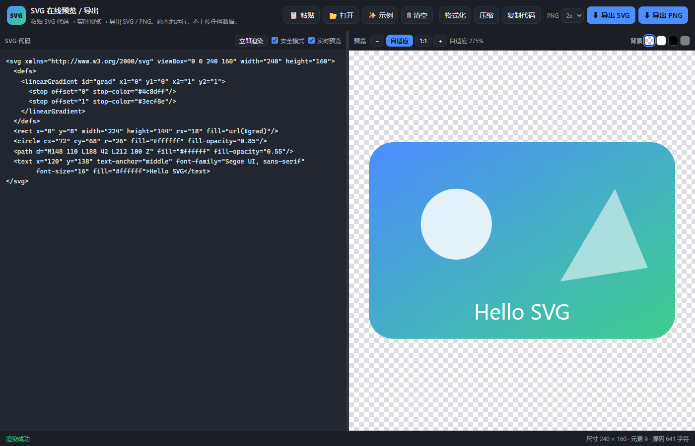

# Tools 工具集

[中文](README.md) | [English](README_EN.md)

一个轻量的网页工具集合,全部由纯 HTML + CSS + JavaScript 编写。下载后直接用浏览器打开即可使用,无需安装依赖,大部分工具完全离线可用。

## 包含工具

### 1. 32 位位选择器 × 6(`bit-to-hex-x6.html`)

一页内提供 6 个相互独立的 32 位数值编辑器,适合拼装寄存器值、掩码或配置字。

功能:

- 32 位二进制逐位开关,顶部带位号(31 → 0),悬停可查看权重
- 实时显示 HEX、无符号十进制、int32 有符号十进制、二进制
- 6 个计算器完全独立,各自支持:清零、全 1、随机、输入 HEX 载入、一键复制
- 每个计算器可填写简短注释,自动保存到浏览器本地(`localStorage`),刷新不丢失
- 自适应布局铺满屏幕:宽屏(≥1400px)3 列 × 2 行,中屏 2 列 × 3 行,手机单列,每卡内位按钮自动折成两排
- 自动适配浅色 / 深色系统主题


### 2. XY 曲线绘图·简易版(`xy-plotter.html`)

最简版数据曲线工具:X、Y 数据分两个文本框粘贴,点「绘图」即可查看曲线,支持同时绘制多条曲线。

功能:

- 多条曲线:点「+ 新增曲线」可任意添加,每条曲线有独立的 X / Y 输入框、名称、颜色,支持删除与显示 / 隐藏;X 留空时自动使用 0, 1, 2, …;数量不一致时按较少一侧绘制
- 标题与轴标签:可修改文字、字体、字号、颜色,并可直接在画布上拖动位置(位置自动保存)
- 坐标轴:线性 / Log10 缩放(自动过滤 0 与负数并提示)、网格开关、折线 / 平滑曲线
- 选点读取:单击数据点可添加/取消标记,支持同时标记多个点并列出各自坐标,「清除全部标记」一键清空
- 刻度方式可选:自动漂亮数(1/2/5×10ⁿ)、等分 N 段、固定步长、数据点位置、自定义刻度列表
- 交互:图例点击显隐曲线、鼠标悬停显示曲线名与精确坐标、框选放大、按住空格或「平移」拖动、双击重置视图
- 数据导出 / 载入:一键导出 CSV(曲线名,x,y,Excel 可打开),也可载入相同格式的 CSV / TXT 恢复多条曲线
- 自动保存:标题、轴标签的文字/字体/字号/颜色与位置、坐标轴与刻度设置、曲线数据都会保存在当前浏览器,刷新后原样恢复
- 导出 PNG;亮色 / 暗色主题切换;完全离线,无任何外部依赖


### 3. SVG 代码预览 / 导出(`svg-preview.html`)

把 SVG 代码粘贴进来即可实时预览,并导出为 SVG 或 PNG 图片,适合快速检查设计稿、图标或整理素材。

功能:

- 实时预览:左侧粘贴代码、右侧即时渲染;可关闭实时预览改用「立即渲染」或 `Ctrl+Enter`
- 容错解析:代码缺少 `xmlns` 会自动补全;语法错误时在预览区给出具体报错信息
- 安全模式(默认开启):自动移除 `<script>` 与 `on*` 事件属性
- 代码整理:一键格式化与压缩;`<text>`、`<tspan>`、`<style>` 等空白敏感元素保持内联,不会改变文字渲染
- 导出 SVG:自动补全命名空间并加上 XML 声明,下载为 `.svg`(快捷键 `Ctrl+S`)
- 导出 PNG:可选 1x / 2x / 4x 分辨率,背景跟随预览(透明格 = 透明底)
- 查看辅助:自适应 / 1:1 / `Ctrl+滚轮` 缩放,透明格 / 白 / 黑 / 灰四档预览背景,并显示尺寸与元素数量
- 载入方式:拖入 `.svg` 文件、`Ctrl+O` 打开、从剪贴板一键读取,或直接 `Ctrl+V` 粘贴
- 自动保存:当前代码保存在浏览器本地,刷新后自动恢复;纯本地运行,不上传任何数据



### 4. SVG 转可编辑 PPT(`svg-to-pptx.html`)

把 SVG 文件或代码转成 PowerPoint 幻灯片,且**每一个元素都是 PPT 原生对象**(矩形、圆、自由曲线、连接线、文本框),不是贴图,可以在 PPT 里继续改颜色、改文字、拖动位置。

功能:

- 两种输入:直接把一个或多个 `.svg` 文件拖进页面(或用「打开 / 目录」按钮批量导入),也可以粘贴 SVG 代码;一个文件 = 一页幻灯片
- 先预览再导出:右侧实时渲染预览,支持缩放(自适应 / 1:1 / `Ctrl+滚轮`)与透明格 / 白 / 黑 / 灰四档背景,底部显示尺寸、元素数与将生成的对象数
- 可编辑性:矩形与圆角矩形→PPT 圆角矩形(圆角半径按 SVG 的 `rx` 等比还原)、圆/椭圆→椭圆、折线/多边形/曲线路径→自由形状(曲线按可调精度抽稀)、两点直线→连接线、`<text>`→文本框(保留字体、字号、粗斜体、颜色、对齐与逐行坐标)
- 样式还原:实色填充、描边宽度、虚线、线帽/拐角、透明度、`<style>` 与 class、`transform`(平移/旋转/缩放/斜切,全部烘焙进坐标)、`<use>`/`<symbol>` 展开
- 降级透明:渐变/图案按色标平均色近似、滤镜/遮罩/裁剪不应用、`<image>` 位图与 `<textPath>` 跳过 —— 每一条都会在左侧面板逐条列出,绝不静默丢内容
- 多页合并:多个 SVG 一次导出为一个 PPTX;画布尺寸不一致时自动等比缩放居中并提示
- 同时保留 PNG(1x / 2x / 4x)与 SVG 导出;`Ctrl+S` 导出 PPTX、`Ctrl+O` 打开文件、`Ctrl+Enter` 立即渲染
- 自动保存当前文件列表到浏览器本地,刷新后恢复;纯本地运行,不上传任何数据,零第三方依赖(PPTX 由页面内自带的 OOXML + ZIP 写入器现场生成)
- 实测:导出的 PPTX 用 PowerPoint 打开无「需要修复」提示,幻灯片尺寸与 SVG 画布 1:1(96dpi),形状位置与原图一致


### 5. 图片公式转 Markdown(`image-to-markdown.html`)

把图片里的**普通文字和数学公式分开**,公式转成 LaTeX,直接输出可复制的 Markdown 源码。适合整理教材截图、论文公式、板书照片、Word 里的公式截图。识别用 **Google Gemini 免费档**,不需要付费服务。

功能:

- 三种输入方式:截图后 `Ctrl+V` 直接粘贴、把图片拖进页面、点「选择图片」打开文件;PNG / JPG / WebP / BMP 都支持
- 输出**原位混合 Markdown**:正文按原图分段、标题用 `#`、列表和表格用 Markdown,行内公式写成 `$...$`、独立公式写成 `$$...$$`,公式落在它在原图中的位置,不会被集中搬到末尾
- 原文语言原样保留(中文仍是中文、英文仍是英文),不会翻译或改写;无法辨认的字符写成 `⟨?⟩` 而不是猜
- 上传前自动预处理:等比缩放到长边 2000px 并转 JPEG,避免超出接口体积限制、加快识别
- 在线编辑与导出:右侧源码框可直接改,一键复制或下载 `.md`
- 附加要求输入框:例如「忽略页眉页码」「公式保留编号」「按原图分行」
- 模型下拉会在填入 Key 后**自动拉取**你账号可用的 Gemini 模型(默认选 flash 系,更快更省额度),Google 改模型名也不用改代码
- **容错自动切换**:选中模型返回 503(过载)/429(限流)/404(旧模型下线)时,会自动改用列表里下一个可用模型重试,不会直接报错让你重来
- 「测试」按钮只请求模型列表验证 Key,不消耗生成额度
- 自动记住 API Key、模型选择与附加要求;`Ctrl+Enter` 识别、`Ctrl+S` 下载 `.md`

> **不想每次输 Key?** 在 HTML 同目录放一个私有文件 `image-to-markdown.keys.local.js`(已被 `.gitignore` 忽略,不会提交):
>
> ```js
> window.I2M_KEYS = { '19991021': '你的真实 API Key' };
> ```
>
> 之后页面会自动读这张表:输入框里只显示 `19991021`,提交时再换算成真实 Key。仓库里没有这个文件也完全不影响使用,只是短代号不生效——所以**真实 Key 永远不会出现在 GitHub 上**。

使用前需要:

- 一个 [Google AI Studio](https://aistudio.google.com/apikey) 的**免费** API Key(页面右上角填入)。Key 只保存在**本机浏览器 localStorage**,不会写进 HTML 文件,也不会提交到仓库
- 能访问 Google 的网络(大陆一般需要代理)。**与其他工具不同,本工具会把图片上传给 Google 做识别**;其余工具仍然全部在本地运行
- 免费档有每分钟 / 每天次数上限,用完会提示 `429`,换模型或稍后重试即可

> 免费档的两个坑(实测):**Pro 类模型免费档不可用**(配额为 0,选了会直接 429),**2.5 系已对新用户下线**(会返回 404)。工具里已经把这两类模型排到列表后面,并且遇错会自动换模型;要查你账号的真实额度,登录后看 [ai.dev/rate-limit](https://ai.dev/rate-limit)。


## 使用方法

1. 克隆或下载本仓库;
2. 用 Chrome / Edge / Firefox 等浏览器直接打开 HTML 文件;
3. 不需要服务器,也不需要安装任何依赖。

> 唯一例外是「图片公式转 Markdown」:它需要在页面里填一个自己的 Google Gemini 免费 Key 并联网(图片会上传给 Google),其余工具完全离线。

## 目录结构

| 文件 | 说明 |
| --- | --- |
| `bit-to-hex-x6.html` | 32 位位选择器 × 6 工具页 |
| `bit-to-hex-x6-preview.png` | 工具预览截图 |
| `xy-plotter.html` | XY 曲线绘图·简易版 |
| `xy-plotter-preview.png` | 工具预览截图 |
| `svg-preview.html` | SVG 代码预览 / 导出工具页 |
| `svg-preview-preview.png` | 工具预览截图 |
| `svg-to-pptx.html` | SVG 转可编辑 PPT 工具页 |
| `svg-to-pptx-preview.png` | 工具预览截图 |
| `image-to-markdown.html` | 图片公式转 Markdown 工具页 |
| `image-to-markdown-preview.png` | 工具预览截图 |
| `README.md` | 本说明文件 |
| `README_EN.md` | English documentation |

## 技术说明

- 纯原生 HTML / CSS / JavaScript,零第三方依赖,离线可用
- 位选择器按 32 位无符号整数计算;bit 31 置位时,`int32` 一栏显示补码形式的负数;注释保存在浏览器 `localStorage`
- 曲线工具中,标题 / 轴标签位置与曲线数据均保存在当前浏览器本地;Log 坐标会自动跳过 0 和负数
- SVG 转 PPT 工具用浏览器 DOM 解析 SVG(自动解析 CSS / class / `style` 与 `transform`),再按 DrawingML 规范现场生成 PPTX 与 ZIP 包,因此不需要任何第三方库;页面还对外暴露 `window.S2P.convert(...)` 与 `?qa=` / `?qaFile=` 两个自动化测试入口,方便脚本回归验证转换结果
- 图片转 Markdown 工具用浏览器 `fetch` 直连 Google Gemini 的 `generativelanguage.googleapis.com/v1beta` 接口(该接口返回允许跨域的响应头,所以纯静态页面从 `file://` 打开也能直接调用),鉴权走 `x-goog-api-key` 请求头,图片以 base64 `inline_data` 传入,由 `systemInstruction` 约束输出格式;页面暴露 `window.I2M.convert(dataUrl, {key, model, extra})` 与 `I2M.listModels(key)`,并支持 `?demo=1`(加载内置示例图,不调用接口)与 `?demo=1&auto=1`(示例图直接跑一次识别)两个自动化入口

## License

当前仓库暂未附带许可证文件。公开发布前建议补充 LICENSE(例如 MIT)并同步更新本说明。
