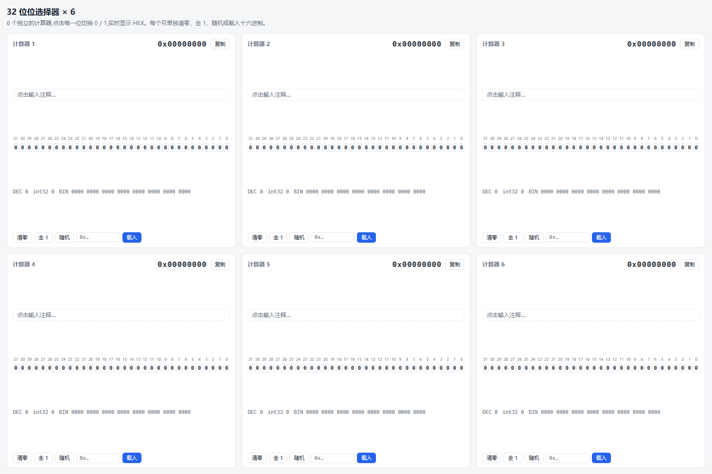
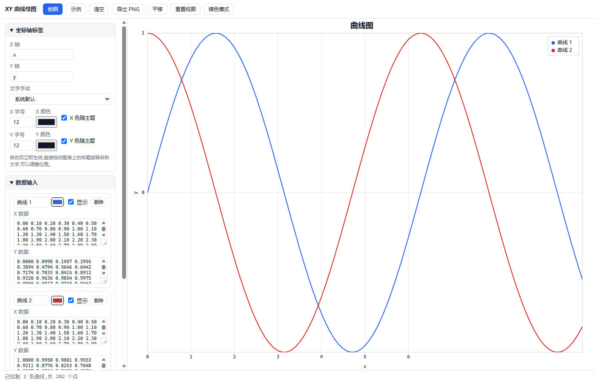
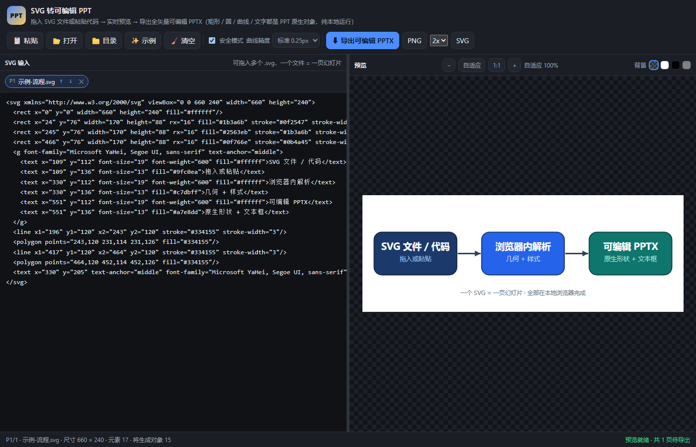
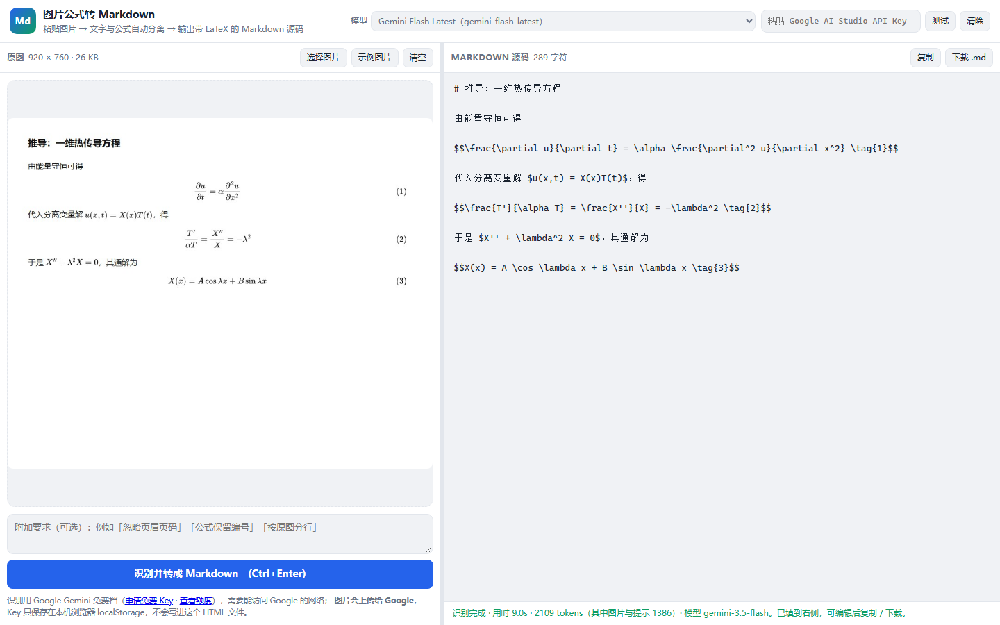

# Tools

[English](README_EN.md) | [中文](README.md)

A lightweight collection of web tools built with plain HTML + CSS + JavaScript. Just download and open them in a browser — no installation or dependencies required, and most tools work fully offline.

## Included Tools

### 1. 32-bit Bit Selector × 6 (`bit-to-hex-x6.html`)

Six independent 32-bit value editors on one page, handy for assembling register values, masks, or configuration words.

Features:

- 32-bit binary toggle switches with bit numbers on top (31 → 0); hover to see the bit weight
- Live display of HEX, unsigned decimal, signed int32 decimal, and binary
- All 6 editors are fully independent, each supporting: clear, all 1s, random, load from HEX input, one-click copy
- Each editor accepts a short note, auto-saved to browser local storage (`localStorage`) — survives refresh
- Responsive layout: 3 columns × 2 rows on wide screens (≥1400px), 2 columns × 3 rows on medium screens, single column on phones; bit buttons wrap into two rows inside each card
- Auto-adapts to light / dark system theme



### 2. XY Plotter · Simple Edition (`xy-plotter.html`)

A minimal data plotting tool: paste X / Y data into two text boxes, click "Plot" to view the curve; multiple curves are supported.

Features:

- Multiple curves: add any number via "+ New Curve", each with its own X / Y inputs, name, and color; supports deletion and show / hide; when X is left empty it defaults to 0, 1, 2, …; mismatched lengths are drawn against the shorter one
- Title and axis labels: editable text, font, size, and color; draggable directly on the canvas (position auto-saved)
- Axes: linear / log10 scaling (automatically filters and warns about 0 and negative values), grid toggle, polyline / smooth curve
- Point picking: click a data point to add/remove a marker, mark multiple points at once with coordinates listed, one-click "Clear all markers"
- Tick modes: auto pretty numbers (1/2/5×10ⁿ), N equal segments, fixed step, data point positions, custom tick list
- Interaction: click the legend to show/hide curves, hover to show the curve name and exact coordinates, box-select zoom, hold Space or "Pan" to drag, double-click to reset the view
- Data export / import: one-click CSV export (curve name, x, y — opens in Excel), and load same-format CSV / TXT to restore multiple curves
- Auto-save: title, axis label text/font/size/color and positions, axis and tick settings, and curve data are all saved in the current browser and restored on refresh
- PNG export; light / dark theme toggle; fully offline with no external dependencies



### 3. SVG → Editable PowerPoint (`svg-to-pptx.html`)

Turn SVG files or code into a PowerPoint slide deck where **every element is a native PowerPoint object** — auto shapes, freeforms, connectors, and text boxes, never an embedded picture — so the deck stays editable in Office.

Features:

- Two ways in: drag one or more `.svg` files onto the page (or batch-import with the Open / Folder buttons), or paste SVG code; one file = one slide
- Preview before export: live rendering on the right with fit / 1:1 / `Ctrl+wheel` zoom and four backgrounds (checkerboard / white / black / gray); the status bar shows size, element count, and how many objects will be created
- Editability: rects and rounded rects → PowerPoint rounded rectangles (corner radius follows the SVG `rx`), circles / ellipses → ellipses, polylines / polygons / curves → freeform shapes (curves simplified at a selectable tolerance), two-point lines → connectors, `<text>` → text boxes (font, size, bold/italic, colour, alignment, and per-line coordinates preserved)
- Styling: solid fills, stroke width, dash patterns, line caps / joins, opacity, `<style>` and class rules, `transform` (translate / rotate / scale / skew, all baked into coordinates), `<use>` / `<symbol>` expansion
- Honest degradation: gradients and patterns are approximated by their average stop colour, filters / masks / clip paths are not applied, `<image>` bitmaps and `<textPath>` are skipped — every one of them is listed item by item in the left panel, nothing is dropped silently
- Multi-page: several SVGs export into a single PPTX; differing canvas sizes are scaled and centred automatically with a notice
- PNG (1x / 2x / 4x) and SVG export are kept as well, plus **one-click copy of the SVG source** (paste it into an editor or save it as a `.svg`); `Ctrl+S` exports the PPTX, `Ctrl+O` opens files, `Ctrl+Enter` re-renders
- The file list is auto-saved in the browser and restored on refresh; everything runs locally, nothing is uploaded, and there are zero third-party dependencies (the PPTX is built in-page by a bundled OOXML + ZIP writer)
- Verified: the exported PPTX opens in PowerPoint with no repair prompt, the slide size matches the SVG canvas 1:1 (96 dpi), and shapes land where the SVG put them



### 4. Image Formulas → Markdown (`image-to-markdown.html`)

Paste a picture of text mixed with math, and get back **Markdown source with the plain text and the formulas separated** — every formula converted to LaTeX. Handy for textbook screenshots, paper equations, whiteboard photos, and formula screenshots from Word. Recognition runs on the **Google Gemini free tier**, so no paid service is involved.

Features:

- Three ways in: paste a screenshot with `Ctrl+V`, drag an image onto the page, or use the Open button; PNG / JPG / WebP / BMP supported
- In-place Markdown output: paragraphs, `#` headings, Markdown lists and tables follow the original layout; inline math becomes `$...$`, display math becomes `$$...$$`, and every formula stays where it was in the picture instead of being swept to the end
- Nothing is translated or rewritten — the original language is preserved — and unreadable glyphs are marked `⟨?⟩` instead of guessed
- Pre-processing before upload: images are scaled to a 2000 px long edge and converted to JPEG, keeping them inside the API size limit and speeding up recognition
- Edit, copy, or download the resulting `.md` straight from the page
- Optional "extra instructions" box, e.g. "ignore headers and page numbers", "keep equation numbers", "break lines as in the original"
- The model dropdown **loads the models your key can use** as soon as a key is entered (flash-class models are picked by default: faster and lighter on your quota), so a Google model rename never needs a code change
- **Self-healing fallback**: if the selected model returns 503 (overloaded) / 429 (rate limited) / 404 (retired for new users), the page automatically retries with the next usable model instead of failing outright
- The "Test" button only fetches the model list to validate the key — it spends no generation quota
- API key, model choice, and extra instructions are remembered locally; `Ctrl+Enter` runs recognition, `Ctrl+S` downloads the `.md`

> **Don't want to type the key each time?** Drop a private file named `image-to-markdown.keys.local.js` next to the HTML (it is `.gitignore`d and never committed):
>
> ```js
> window.I2M_KEYS = { '19991021': 'your real API key' };
> ```
>
> The page then shows only `19991021` in the input and swaps in the real key when calling the API. The repository works fine without that file — only the short alias stops resolving — so **the real key never lands on GitHub**.

Before you start you need:

- A **free** [Google AI Studio](https://aistudio.google.com/apikey) API key, entered in the top-right of the page. The key is kept only in your browser's `localStorage` — it is never written into the HTML file and never committed to this repository
- A network connection that can reach Google (usually a proxy is required from mainland China). **Unlike the other tools, this one uploads your image to Google for recognition**; everything else in this repository still runs entirely locally
- The free tier has per-minute and per-day limits; when you hit them the page reports `429` — switch models or retry later

> Two free-tier traps we hit in testing: **Pro-class models are not available on the free tier** (quota is 0, so they fail with 429), and the **2.5 family has been retired for new users** (404). The page ranks both kinds to the bottom of the list and falls back automatically; to see the real numbers for your account, sign in and open [ai.dev/rate-limit](https://ai.dev/rate-limit).



## Usage

1. Clone or download this repository;
2. Open the HTML files directly in Chrome / Edge / Firefox or another browser;
3. No server and no dependencies needed.

> The only exception is "Image Formulas → Markdown": it needs your own free Google Gemini key and a network connection (the image is uploaded to Google). Every other tool works fully offline.

## File Structure

| File | Description |
| --- | --- |
| `bit-to-hex-x6.html` | 32-bit bit selector × 6 tool page |
| `bit-to-hex-x6-preview.png` | Tool preview screenshot |
| `xy-plotter.html` | XY plotter · simple edition |
| `xy-plotter-preview.png` | Tool preview screenshot |
| `svg-to-pptx.html` | SVG → editable PowerPoint tool page |
| `svg-to-pptx-preview.png` | Tool preview screenshot |
| `image-to-markdown.html` | Image formulas → Markdown tool page |
| `image-to-markdown-preview.png` | Tool preview screenshot |
| `README.md` | Chinese documentation |
| `README_EN.md` | This documentation (English) |

## Technical Notes

- Pure vanilla HTML / CSS / JavaScript, zero third-party dependencies, works offline
- The bit selector computes with 32-bit unsigned integers; when bit 31 is set, the `int32` column shows the two's-complement negative value; notes are saved in browser `localStorage`
- In the plotter, title / axis label positions and curve data are saved locally in the current browser; log axes automatically skip 0 and negative values
- The SVG → PPT tool parses SVG with the browser DOM (so CSS / class / `style` rules and `transform` are resolved for free) and then writes the PPTX and ZIP packages directly from the DrawingML specification — hence no third-party library. The page also exposes `window.S2P.convert(...)` plus the `?qa=` / `?qaFile=` entry points used by the automated regression checks
- The image → Markdown tool calls Google Gemini's `generativelanguage.googleapis.com/v1beta` endpoint directly from the browser with `fetch` (it sends permissive CORS headers, so a static page opened from `file://` can call it with no server), authenticating with the `x-goog-api-key` header and passing the image as base64 `inline_data`, with a `systemInstruction` pinning the output format. The page exposes `window.I2M.convert(dataUrl, {key, model, extra})` and `I2M.listModels(key)`, and supports `?demo=1` (loads a built-in sample image, no API call) and `?demo=1&auto=1` (runs one real recognition on the sample) for automated checks

## License

This repository does not currently include a license file. Consider adding a LICENSE (e.g. MIT) before public release and updating this documentation accordingly.
